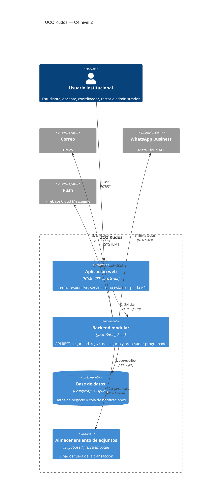
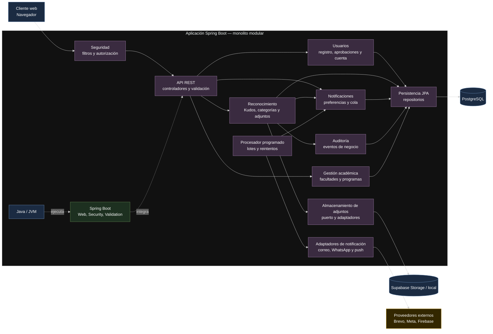
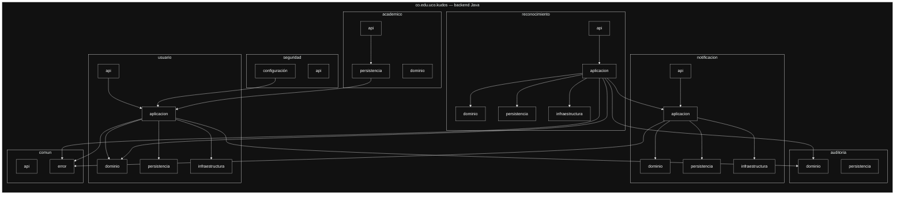
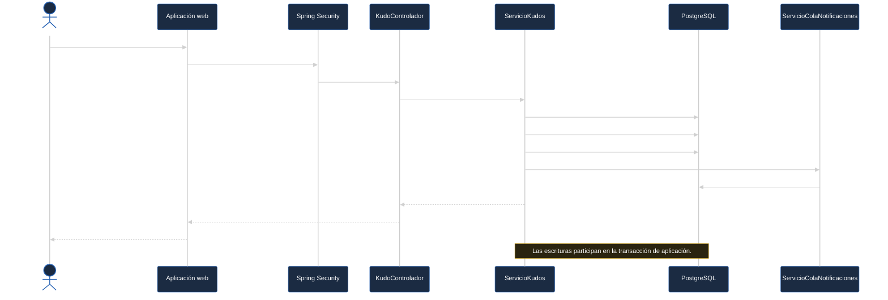

# Diseño de arquitectura — UCO Kudos

## C4 nivel 2 — contenedores

## Diagrama de componentes — backend

**Leyenda:** morado = componentes propios; verde = framework; azul = plataforma y almacenamiento base; ocre = servicios externos.

**Responsabilidades y límites:** `api` traduce HTTP a llamadas de aplicación y no contiene reglas de negocio. Los servicios de aplicación coordinan casos de uso; dominio contiene entidades y estados. Repositorios y puertos de almacenamiento aíslan infraestructura. En la implementación actual algunos servicios de aplicación dependen directamente de interfaces concretas de repositorio Spring; es una modularidad por paquetes/capas, no una Clean Architecture estricta en todos los puntos.

## Diagrama de paquetes

El contorno y las pestañas de paquetes replican la vista UML de la referencia; las flechas indican dependencias observadas, no flujo de ejecución. El frontend no aparece como paquete Java porque en UCO Kudos son recursos estáticos servidos por el backend.

## Diagramas de secuencia principales

### Publicar Kudo y programar notificaciones

## Drivers arquitectónicos

| ID | Driver y prioridad | Respuesta arquitectónica de la línea base | Evidencia / brecha |
|---|---|---|---|
| DRV-001 | Movilidad; 90% móvil, alta | Interfaz web estática separada de la API lógica y diseño responsive; servir recursos desde el backend reduce despliegue inicial. | Revisar estilos y probar tamaños móviles; el documento define Mobile First, pero no aporta métricas de usabilidad/performance móvil. |
| DRV-002 | Alta demanda de lectura, alta | Consultas paginadas; límite de 50 registros por página; transacciones de solo lectura en listado. | JPA/PostgreSQL; índices de consultas críticas deben comprobarse con volumen real. Caché no identificada en la línea base. |
| DRV-003 | Multicanal, alta | Puerto `AdaptadorNotificaciones`, adaptadores por proveedor y cola persistida con reintentos. | Mail, WhatsApp, push disponibles como adaptadores. Operación efectiva depende de credenciales, consentimiento y perfil; no hay broker externo. |
| DRV-004 | Adjuntos, alta | Puerto `AlmacenamientoAdjuntos` y adaptadores Supabase/local; metadatos separados del binario. | `ServicioAdjuntosKudo`; políticas de tamaño/tipo, análisis antimalware, respaldo y retención deben definirse/desplegarse. |
| DRV-005 | Seguridad, crítica | Spring Security, autenticación HTTP Basic sin estado, autorización autenticada, validación de entrada y CSRF. | Revisar autorización por rol en cada caso de uso, transporte HTTPS y secretos externos; no guardarlos en el repositorio. |
| DRV-006 | Observabilidad y trazabilidad, alta | Actuator expone health/info; auditoría de eventos en base; logs del procesador capturan fallos sin el contenido sensible. | Métricas y trazas distribuidas no están expuestas/configuradas en `application.yml`; completar antes de afirmar observabilidad integral. |
| DRV-007 | Automatización DevSecOps, alta | Contenedorización y configuración de despliegue (`Dockerfile`, `render.yaml`); pruebas existentes. | En los archivos listados no aparecen workflows CI/CD ni configuración Sonar/Trivy; agregar pipeline y evidencias para cumplir el enunciado. |

## ADR — decisiones arquitectónicas

Estado: decisiones documentadas retrospectivamente a partir de la implementación actual. Si se cambia la solución, registrar una nueva ADR en vez de sobrescribir la historia.

### ADR-001 — Monolito modular como línea base

- **Estado:** Aceptada.
- **Contexto:** El alcance incluye varios módulos de negocio, pero el equipo y la línea base son individuales y el despliegue debe ser sencillo.
- **Decisión:** Desplegar una aplicación Spring Boot única organizada en módulos por dominio (`usuario`, `reconocimiento`, `notificacion`, `academico`, `auditoria`).
- **Consecuencias:** Menor costo operacional, transacciones locales y despliegue simple. El escalado es principalmente vertical/replicando toda la aplicación; los módulos comparten proceso y base de datos. Extraer servicios requiere necesidad y límites medidos.

### ADR-002 — PostgreSQL como almacenamiento transaccional

- **Estado:** Aceptada.
- **Contexto:** Identidades, relaciones académicas, publicaciones, auditoría y trabajos de notificación requieren integridad referencial y consistencia.
- **Decisión:** Usar PostgreSQL mediante Spring Data JPA; evolucionar esquema con Flyway y validar el mapeo Hibernate (`ddl-auto: validate`).
- **Consecuencias:** Buen soporte para consultas relacionales y transacciones; el escalado de lectura futuro puede incorporar índices, réplicas o caché tras medir. La cola comparte disponibilidad y capacidad con la base operacional.

### ADR-003 — Cola de notificaciones persistida en PostgreSQL

- **Estado:** Aceptada.
- **Contexto:** La publicación del Kudo no debería esperar las llamadas a proveedores y los fallos externos requieren reintentos.
- **Decisión:** Encolar un trabajo por canal en la misma transacción lógica del caso de uso y procesarlo en lotes con bloqueo temporal, espera incremental y máximo de ocho intentos.
- **Consecuencias:** No requiere broker adicional y conserva trabajos ante reinicios; genera carga en la base y el patrón puede duplicar entregas si un proveedor acepta el mensaje y falla la confirmación local. Las integraciones deben usar idempotencia cuando esté disponible. Evolucionar a outbox/broker si escala o aislamiento operacional lo exige.

### ADR-004 — Almacenamiento de binarios detrás de un puerto

- **Estado:** Aceptada.
- **Contexto:** Los adjuntos requieren poder cambiar entre desarrollo local y almacenamiento administrado.
- **Decisión:** Encapsular operaciones en `AlmacenamientoAdjuntos` con adaptadores local y Supabase.
- **Consecuencias:** Facilita cambiar el proveedor; requiere política de acceso, expiración/enlaces seguros, límites, respaldo y reconciliación de metadatos.

### ADR-005 — Adaptadores por canal de notificación

- **Estado:** Aceptada.
- **Contexto:** Correo, WhatsApp y push tienen APIs, credenciales, errores y requisitos de consentimiento distintos.
- **Decisión:** Seleccionar un `AdaptadorNotificaciones` por canal, configurando implementaciones productivas y de demostración/deshabilitadas.
- **Consecuencias:** Aísla dependencias externas y permite sustituir proveedores. El estado de demo/simulado no equivale a entrega real; WhatsApp debe respetar autorización y reglas de plantillas del proveedor.

### ADR-006 — Autenticación de aplicación web con Spring Security

- **Estado:** Aceptada.
- **Contexto:** Las operaciones requieren usuario autenticado; el cliente web se sirve desde el mismo origen.
- **Decisión:** Centralizar autenticación en Spring Security con HTTP Basic y política sin estado; proteger solicitudes mutables con CSRF y exponer identidad a través del principal autenticado.
- **Consecuencias:** Reduce lógica de autenticación dispersa y evita estado de sesión en servidor. HTTP Basic exige HTTPS; deben revisarse autorización por rol y caso de uso, manejo de credenciales, protección contra fuerza bruta y configuración CSRF en producción.

### ADR-007 — Auditoría de eventos de negocio en base de datos

- **Estado:** Aceptada.
- **Contexto:** El requisito de publicación exige trazabilidad y el historial debe sobrevivir al proceso de aplicación.
- **Decisión:** Registrar evento `KUDO_PUBLICADO` asociado con actor, entidad y fecha en la transacción de publicación.
- **Consecuencias:** El registro de publicación es consistente con el Kudo; los permisos de modificación/retención y la cobertura de otros eventos deben definirse para auditoría institucional completa. Auditoría de negocio complementa, no reemplaza, logs y métricas.

## ABB y SBB observados

| ABB | SBB / tecnología de la línea base |
|---|---|
| API de aplicación | Spring Boot Web MVC, controladores REST y DTO |
| Identidad y autorización | Spring Security, usuario institucional y roles |
| Persistencia transaccional | PostgreSQL, Spring Data JPA, Flyway |
| Archivos | `AlmacenamientoAdjuntos`; Supabase Storage o filesystem local |
| Notificaciones | Cola PostgreSQL, procesador `@Scheduled`, adaptadores Brevo, Meta WhatsApp y Firebase |
| Auditoría | Eventos de dominio persistidos en PostgreSQL |
| Salud operacional | Spring Boot Actuator health/info; logs SLF4J |
| Empaquetado y despliegue | Docker y configuración Render |

## Aspectos que requieren cerrar para afirmar cumplimiento completo

- Push a usuarios conectados específicamente: definir presencia/conexión o reformular como push a dispositivos registrados.
- Observabilidad: agregar métricas de negocio/proveedor y trazas; actualmente Actuator expone health/info.
- Seguridad de adjuntos: límites, validación de contenido, autorización de descarga, antivirus y estrategia de recuperación.
- DevSecOps: incorporar CI/CD, Sonar y Trivy, con evidencias de ejecución.
- Escala de lecturas: medir consultas y definir índices; añadir caché o réplica únicamente con evidencia de necesidad.
